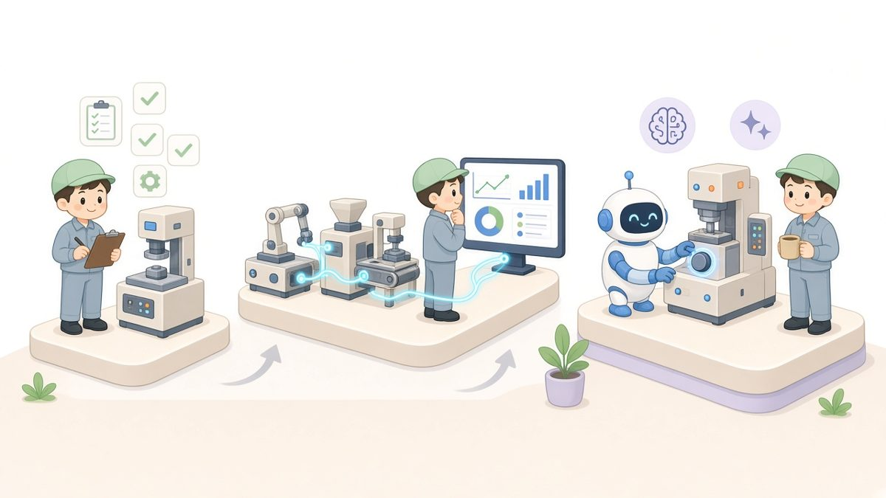

*Disclosure: I work as a principal researcher (service planning) at INTERX, a Korean manufacturing AI company (founded 2020). This article is my personal summary based on public sources such as Korean government documents and international standards; it does not represent my employer's official position.*

If you follow manufacturing technology in Korea, you have probably noticed a new phrase showing up in policy papers and trade press: **AI autonomous manufacturing** (AI 자율제조). It often appears next to two older terms, **smart factory** and **MES** (Manufacturing Execution System), and the three are easy to blur together.

They are not competing options, and none of them replaces the others. They describe different layers. The shortest way I can put it:

- **MES** is a *system* that records and manages production.
- A **smart factory** is a factory that *connects and visualizes* its data.
- **AI autonomous manufacturing** is a factory where *AI makes decisions and acts on them*, with people supervising.

<figure><figcaption>MES (record &amp; manage) → Smart factory (connect &amp; visualize) → AI autonomous manufacturing (decide &amp; control)</figcaption></figure>

## At a glance

| | MES | Smart factory | AI autonomous manufacturing |
|---|---|---|---|
| What it is | A production execution system (software) | A way and level of running a factory (concept) | A way and level of running a factory (concept) |
| Purpose | Manage work orders, production results, and lot history | Improve efficiency by collecting, connecting, and visualizing data | Determine optimal conditions and operate autonomously |
| Main data | Work orders, production output, material history | Integrated MES, ERP, sensor, and equipment data | All of the above, plus training data such as process conditions and images |
| Who decides | People | People (based on data) | AI recommends or controls; people supervise |
| Maturity stage | A foundation that accumulates execution records | Closer to Basic through Intermediate (checking, analysis, optimization) | Closer to Advanced (autonomous operation) |
| Example | Lot tracking, issuing work orders | Real-time monitoring dashboard | AI recommends and applies process settings; vision AI makes automatic pass/fail calls |

*The "Maturity stage" row is my own reading of the Ministry of SMEs and Startups smart-factory levels (Basic, Intermediate 1, Intermediate 2, Advanced). It does not mean an MES has to be in place before the next stage is possible.*

## The questions people actually ask

### What is AI autonomous manufacturing?

It is a way of manufacturing in which AI reads process data, makes judgments, and, combined with robots and equipment, pushes production toward higher sophistication and autonomy.

Korea's Ministry of Trade, Industry and Energy (MOTIE) defined it in its May 2024 *AI Autonomous Manufacturing Strategy 1.0* as, roughly, "a future manufacturing environment that achieves advanced and autonomous production by combining robots, equipment and the like with manufacturing processes on the basis of AI" (my translation of the Korean original).

The practical difference is where the loop closes. A smart factory can put a defect on a screen. AI autonomous manufacturing aims to go further: find the process condition likely causing the defect and change it.

### How is that different from a smart factory?

The two overlap, but they are not the same thing. "Smart factory" is a broad concept: using ICT to connect a plant and make it visible. AI autonomous manufacturing is closer to a stage built on top of that, where AI takes on judgment and control.

Korea's Ministry of SMEs and Startups describes smart factory maturity in four levels in its smart factory support program: **Basic** (checking and monitoring), **Intermediate 1** (analysis and control), **Intermediate 2** (optimization), and **Advanced** (autonomous operation). Seen through that lens, AI autonomous manufacturing is an effort to reach the "Advanced" end of the smart factory scale using AI.

In one line, the difference is about *who decides* and *which maturity stage* you are closest to. In a smart factory, people decide after looking at connected data; in AI autonomous manufacturing, AI recommends or controls, and people supervise.

### If we already have an MES, do we still need AI?

Yes, because they answer different questions. An MES tells you *what happened*. AI deals with *what is likely to happen and what should change*.

The international standard ISA-95 (IEC 62264) places MES at Level 3, manufacturing operations management, between business systems such as ERP (Level 4) and control layers such as PLCs and DCS (Level 2). The production and history data piling up in an MES is actually good training material for AI, which is why plants with a well-run MES tend to adopt AI faster. An MES is a starting point for AI, not a substitute.

### Do you need a full MES and smart factory before attempting AI autonomous manufacturing?

Not necessarily. What you do need is the data relevant to the problem you are trying to solve. For example, to reduce defects in injection molding, process conditions (temperature, pressure, time) need to be linked to the pass/fail results for each part. I have a checklist of which data to prepare first in [Before AI, Get Your Data Ready: 5 Datasets Small Manufacturers Should Prepare](/en/ai-data-readiness-small-manufacturers/).

### Where should a small or mid-sized manufacturer start?

Pick one problem whose impact is easy to measure in numbers, such as the defect rate on a specific line or unplanned stops on a specific machine.

The starting order is as follows.

1. Define the problem and the target metric (write down the "before" number together with the time period).
2. Check whether the data you need exists, and whether collection frequency and standards are consistent.
3. Run a small proof of concept (PoC) and confirm the effect in numbers.
4. If the effect holds up, expand to other lines.

In Korea, the government's smart factory level assessment is also a useful way to check where your plant stands before you begin.

## Korea's policy context

In May 2024, MOTIE announced its **AI Autonomous Manufacturing Strategy 1.0**, and in July 2024 it launched the **AI Autonomous Manufacturing Alliance**, stating a plan to pursue 200 leading projects by 2028. The alliance started with 153 companies and institutions across 12 industries. In May 2025, the ministry added the **Industrial Complex AX Caravan**, a program in which AI companies visit manufacturers in industrial complexes to provide consulting on AI transformation.

The policy frame later widened to manufacturing AI transformation, or **M.AX** (Manufacturing AI Transformation). In a 4 August 2026 work report, MOTIE said the M.AX Alliance had grown to about 1,500 participating organizations, with a goal of 500 AI factories by 2030. In the same briefing it said it had supported about 170 workplaces in AI-factory leading projects, and that a review of 42 workplaces where results had begun to appear showed average productivity up 30.1% and average defect rates down 15.5%. On 3 November 2026, in its *AI Factory Expansion Strategy*, the ministry updated the support tally to 245 companies nationwide and said 38 outstanding cases confirmed the same 30.1% productivity gain and 15.5% defect-rate reduction. The two counts use different denominators, so they should not be mixed. The detailed support terms need to be checked in each year's official call.

For readers outside Korea, the point is that "AI autonomous manufacturing" is not just a marketing label there. It is a named policy category with a government definition, which is one reason the term now appears so often in Korean industry discussions.

### Do we have to upgrade the MES first, and only then start AI?

**You do not have to wait until both are finished. What comes first is whether the data for the problem you want to solve is already linked.**

A fully upgraded MES is not a prerequisite for starting AI. If work orders, output, and lot history are already accumulating in the MES, that is a good starting point for training. Even if the MES is weak, you can still run a small test on one problem when process conditions and pass/fail results on a given line are tied to the same product unit. Whether to finish the whole system first or start with one problem depends on how the data is connected.

### How can we tell what level our plant is at now?

**A practical first step is the Ministry of SMEs and Startups smart-factory level assessment, which places a plant near Basic, Intermediate 1, Intermediate 2, or Advanced.**

The level names are checking and monitoring, analysis and control, optimization, and autonomous operation. AI autonomous manufacturing is closest to the Advanced (autonomous operation) end. The level name is not, by itself, the introduction sequence. Seeing which data you already have at your current level matters more than making a shopping list of the next system to install.

### How do MES, ERP, and a smart factory differ?

**ERP and MES are software layers. A smart factory is a way and level of running a plant.**

ISA-95 (IEC 62264) places ERP at Level 4 (business), MES at Level 3 (manufacturing operations management), and control systems such as PLCs and DCS at Level 2. A smart factory is the broader idea of tying these systems together so data can be connected and visualized; it does not refer to MES or ERP alone.

## Three differences to remember

1. **What it is.** MES is a system (software). Smart factory and AI autonomous manufacturing describe how, and how far, a factory is run.
2. **What happens to the data.** MES records it, a smart factory connects and displays it, and AI autonomous manufacturing uses it to decide what to change next.
3. **Who makes the call.** With MES and a smart factory, people decide based on data. In AI autonomous manufacturing, AI recommends or directly controls process conditions, and people supervise.

*The original, longer FAQ (in Korean) is on my blog: [AI 자율제조 vs 스마트팩토리 vs MES, 뭐가 다를까?](https://blog.naver.com/sangza40/224448962411)*

## Related

- [Before AI, Get Your Data Ready: 5 Datasets Small Manufacturers Should Prepare](/en/ai-data-readiness-small-manufacturers/) ([Korean version](/ko/ai-data-readiness-small-manufacturers/))

## Sources

- MOTIE, "Drawing the path for Korean industry in the AI era" (AI Autonomous Manufacturing Strategy 1.0, 2024-05-08), Korea Policy Briefing (Korean): https://m.korea.kr/briefing/pressReleaseView.do?newsId=156629475
- MOTIE, "Manufacturing AI adoption to expand to 40%; 200 leading projects" (launch of the AI Autonomous Manufacturing Alliance, 2024-07-22), Korea Policy Briefing (Korean): https://www.korea.kr/news/policyNewsView.do?newsId=148931737
- MOTIE, "On-site AI transformation support: Industrial Complex AX Caravan launched" (2025-05-20, Korean): https://www.motie.go.kr/kor/article/ATCL8764a1224/155118874/view
- MOTIE, "Manufacturing AI transformation: productivity up 30%, defect rates down 15%" (2026-08-04), Korea Policy Briefing (Korean): https://www.korea.kr/news/policyNewsView.do?newsId=148969347
- MOTIE, "Korea to overhaul manufacturing with a four-stage manufacturing-AI expansion strategy" (2026-11-03), Korea Policy Briefing (Korean): https://www.korea.kr/briefing/pressReleaseView.do?newsId=156787789
- Ministry of SMEs and Startups, Smart Factory program, "Introduction of Support Project" (definition and levels): https://www.smart-factory.kr/eng/smartFactory.do?menuId=03
- ISA, ISA-95 Standard: Enterprise-Control System Integration: https://www.isa.org/standards-and-publications/isa-standards/isa-95-standard

*I work as a principal researcher (service planning) at INTERX, a Korean manufacturing AI company (founded 2020). Views are my own.*
