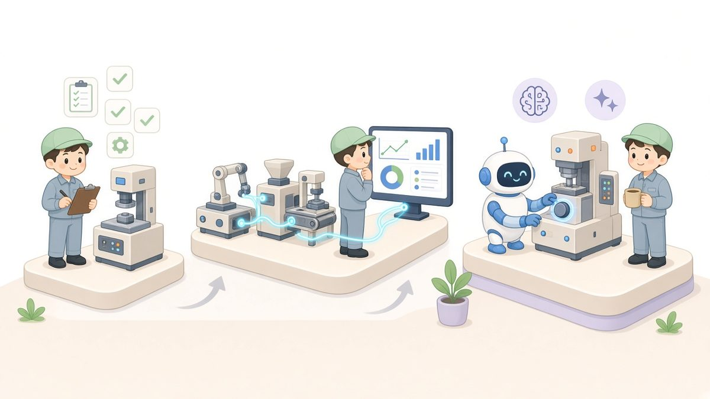

저는 2020년 울산에서 설립된 제조 AI 기업 인터엑스(INTERX)에서 서비스기획을 담당하는 책임연구원입니다. 이 글은 정부 자료와 국제 표준 등 공개 자료를 바탕으로 개인적으로 정리한 내용이며, 회사 공식 입장과는 다를 수 있습니다.

세 가지는 서로 대체하는 개념이 아니라 **층위가 다른 개념**입니다. 한 줄로 줄이면 MES는 '기록하고 관리하는 시스템', 스마트팩토리는 '연결하고 보여주는 공장', AI 자율제조는 'AI가 판단하고 제어까지 하는 공장'입니다.

## 한눈에 비교

| 구분 | MES | 스마트팩토리 | AI 자율제조 |
|---|---|---|---|
| 정체 | 생산 실행 시스템(소프트웨어) | 공장 운영 방식·수준(개념) | 공장 운영 방식·수준(개념) |
| 목적 | 작업지시, 실적, 이력(LOT) 관리 | 데이터 수집·연결·가시화로 효율화 | 최적 조건을 판단하고 자율 운영 |
| 주요 데이터 | 작업지시, 생산실적, 자재 이력 | MES·ERP·센서·설비 데이터 통합 | 위 데이터 + 공정 조건·이미지 등 학습 데이터 |
| 의사결정 주체 | 사람 | 사람(데이터를 근거로) | AI가 권고·제어, 사람은 감독 |
| 발전 단계 | 실행 기록을 쌓는 기반 | 기초~중간(확인·분석·최적화)에 가깝다 | 고도화(자율 운영) 쪽에 가깝다 |
| 예시 | LOT 추적, 작업지시 발행 | 실시간 모니터링 대시보드 | AI가 공정 조건을 추천·반영, 비전 AI 자동 판정 |

※ '발전 단계' 행은 중소벤처기업부 스마트공장 수준(기초·중간1·중간2·고도화)에 비춘 개인 정리입니다. MES가 있어야만 다음 단계로 갈 수 있다는 뜻은 아닙니다.

<figure><figcaption>MES(기록·관리) → 스마트팩토리(연결·가시화) → AI 자율제조(판단·제어)</figcaption></figure>

## Q1. AI 자율제조란 무엇인가요?
**AI가 공정 데이터를 보고 판단하며, 로봇·장비와 결합해 생산을 스스로 고도화·자율화하는 제조 방식입니다.** 산업통상자원부는 2024년 5월 발표한 'AI 자율제조 전략 1.0'에서 AI 자율제조를 "AI를 기반으로 로봇·장비 등을 제조 공정에 결합시켜 생산의 고도화와 자율화를 구현하는 미래 제조환경"으로 정의했습니다.
핵심은 불량을 화면에 띄우는 데서 그치지 않고, 원인이 될 공정 조건을 찾아 바꾸는 것까지 간다는 점입니다.

## Q2. 스마트팩토리와 AI 자율제조는 어떻게 다른가요?
**겹치지만 같지 않습니다. 스마트팩토리는 ICT로 공장을 연결·가시화하는 넓은 개념이고, AI 자율제조는 그 위에서 AI가 판단과 제어를 맡는 단계에 가깝습니다.**
중소벤처기업부 스마트공장 사업 안내는 수준을 기초(확인·모니터링), 중간1(분석·제어), 중간2(최적화), 고도화(자율 운영)로 나눕니다. 이 기준으로 보면 AI 자율제조는 스마트팩토리의 '고도화' 쪽 끝을 AI로 구현하려는 흐름이라고 이해하면 쉽습니다.
차이를 한 줄로 다시 말하면, 핵심은 '의사결정 주체'와 '발전 단계'입니다. 스마트팩토리에서는 사람이 연결된 데이터를 보고 결정하고, AI 자율제조에서는 AI가 권고하거나 제어하며 사람은 감독합니다.

## Q3. MES가 있으면 AI가 필요 없나요?
**아닙니다. MES는 '무엇이 일어났는지'를 기록·관리하고, AI는 '무엇이 일어날지, 어떻게 바꿔야 할지'를 다룹니다.**
국제 표준 ISA-95(IEC 62264)는 MES를 ERP(Level 4)와 PLC·DCS 같은 제어 계층(Level 2) 사이의 Level 3, 즉 '제조 운영 관리' 시스템으로 설명합니다. 오히려 MES에 쌓인 실적·이력 데이터는 AI 학습의 좋은 재료라서, MES가 잘 돼 있는 공장이 AI 도입도 빠른 편입니다.

## Q4. AI 자율제조를 하려면 MES·스마트팩토리를 다 갖춰야 하나요?
**전부 갖출 필요는 없지만, 해결하려는 문제에 필요한 데이터는 꼭 모여 있어야 합니다.**
예를 들어 사출 불량을 줄이려면 공정 조건(온도·압력·시간)과 양불 판정 결과가 연결돼 있어야 합니다. 어떤 데이터를 먼저 보면 되는지는 [중소 제조기업 AI 도입 전 준비할 데이터 5가지](/ko/ai-data-readiness-small-manufacturers/)에 체크리스트로 정리해 두었습니다(네이버 원문: https://blog.naver.com/sangza40/224451245938).

## Q5. 중소 제조기업은 어디서부터 시작하나요?
**효과를 숫자로 확인하기 쉬운 문제 하나(특정 라인 불량률, 특정 설비 돌발 정지 등)부터 시작하는 것을 권합니다.**

시작 순서는 아래와 같습니다.

1. 문제와 목표 지표 정하기 (개선 전 숫자를 기간과 함께 적어 두기)
2. 그 문제에 필요한 데이터가 있는지, 수집 주기와 기준이 맞는지 점검하기
3. 소규모 검증(PoC)으로 효과를 숫자로 확인하기
4. 효과가 확인되면 다른 라인으로 확장하기

정부의 스마트공장 수준확인으로 우리 공장 단계를 먼저 점검해 보는 것도 방법입니다.

## Q6. 정부는 AI 자율제조를 어떻게 지원하나요?
**산업통상자원부가 2024년 'AI 자율제조 전략 1.0'을 발표하고 'AI 자율제조 얼라이언스'를 출범시켜 2028년까지 200대 선도 프로젝트를 추진한다고 밝혔습니다.**
2024년 7월 출범한 얼라이언스에는 12개 업종 153개 기업·기관이 참여했습니다. 2025년 5월에는 산업단지 입주기업을 AI 기업이 찾아가 컨설팅하는 '산업단지 AX 카라반'도 출범했습니다.

이후 정책의 범위는 제조업 인공지능 전환(M.AX, Manufacturing AI Transformation)으로 넓어졌습니다. 산업부는 2026년 8월 4일 업무보고에서 M.AX 얼라이언스 참여기관이 1,500여 개이며, 2030년까지 AI 팩토리 500개 구축을 목표로 한다고 밝혔습니다. 같은 발표에서 AI 팩토리 선도 프로젝트로 170여 개 사업장을 지원했고, 성과가 나타나기 시작한 42개 사업장을 점검한 결과 생산성은 평균 30.1% 높아지고 불량률은 평균 15.5% 낮아졌다고 설명했습니다. 2026년 11월 3일 발표한 「AI 팩토리 확산전략」에서는 지원 대상을 전국 245개 기업으로 업데이트했고, 38개 우수사례를 통해 생산성 30.1% 향상, 불량률 15.5% 감소를 확인했다고 밝혔습니다. 세부 지원 조건은 해마다 공고로 확인해야 합니다.

## Q7. MES를 먼저 고도화한 뒤에 AI를 해야 하나요?
**둘 다 끝나기를 기다릴 필요는 없습니다. 풀려는 문제에 필요한 데이터가 연결돼 있는지가 먼저입니다.**
MES를 완전히 고도화해야만 AI를 시작할 수 있는 것은 아닙니다. MES에 작업지시·실적·LOT 이력이 잘 쌓여 있으면 AI 학습의 좋은 출발점이 됩니다. 반대로 MES가 약해도, 특정 라인의 공정 조건과 양불 결과가 같은 제품 단위로 이어져 있으면 그 문제부터 소규모로 검증할 수 있습니다. '시스템 전체를 먼저 완성할지, 문제 하나부터 볼지'는 데이터 연결 상태를 보고 정하면 됩니다.

## Q8. 우리 공장이 지금 어느 수준인지는 어떻게 확인하나요?
**중기부 스마트공장 수준확인으로 기초·중간1·중간2·고도화 가운데 어디에 가까운지 먼저 보는 것을 권합니다.**
수준 이름은 '확인·모니터링 / 분석·제어 / 최적화 / 자율 운영'입니다. AI 자율제조는 이 가운데 고도화(자율 운영) 쪽에 가깝습니다. 다만 수준 이름이 곧 도입 순서는 아닙니다. 지금 단계에서 어떤 데이터가 이미 있는지를 보는 것이, 다음 시스템 도입 목록을 만드는 일보다 먼저입니다.

## Q9. MES, ERP, 스마트팩토리는 어떻게 다른가요?
**ERP와 MES는 소프트웨어 계층이고, 스마트팩토리는 공장을 운영하는 방식·수준입니다.**
국제 표준 ISA-95(IEC 62264)는 ERP를 Level 4(경영), MES를 Level 3(제조 운영 관리), PLC·DCS 같은 제어를 Level 2로 나눕니다. 스마트팩토리는 이 시스템들을 묶어 데이터를 연결·가시화하는 넓은 개념이라, MES나 ERP 하나를 가리키는 말이 아닙니다.

## 함께 읽기
- [중소 제조기업 AI 도입, 무엇부터 준비하나? 미리 챙길 데이터 5가지](/ko/ai-data-readiness-small-manufacturers/) (네이버 원문: https://blog.naver.com/sangza40/224451245938)

## 참고 자료
- 산업통상자원부, 「인공지능(AI) 시대 우리 산업이 나아갈 길을 그린다」(AI 자율제조 전략 1.0, 2024-05-08), 정책브리핑: https://m.korea.kr/briefing/pressReleaseView.do?newsId=156629475
- 산업통상자원부, 「제조업 AI 도입률 40%로 확대…200개 선도 프로젝트 추진」(AI 자율제조 얼라이언스 출범, 2024-07-22), 정책브리핑: https://www.korea.kr/news/policyNewsView.do?newsId=148931737
- 산업통상자원부, 「찾아가 AI 전환 지원…'산업단지 AX 카라반' 출범」(2025-05-20): https://www.motie.go.kr/kor/article/ATCL8764a1224/155118874/view
- 산업통상부, 「제조업 AI 대전환으로 생산성 30%↑ 불량률 15%↓」(2026-08-04), 정책브리핑: https://www.korea.kr/news/policyNewsView.do?newsId=148969347
- 산업통상부, 「대한민국 제조업 판 바꾼다... 산업부, 제조AI 4단계 확산전략 가동」(2026-11-03), 정책브리핑: https://www.korea.kr/briefing/pressReleaseView.do?newsId=156787789
- 중소벤처기업부 스마트공장 사업관리시스템, Introduction of Support Project(스마트공장 정의·수준): https://www.smart-factory.kr/eng/smartFactory.do?menuId=03
- ISA, ISA-95 Standard: Enterprise-Control System Integration: https://www.isa.org/standards-and-publications/isa-standards/isa-95-standard

*필자는 인터엑스에서 서비스기획을 담당하는 책임연구원이며, 이 글은 공개 자료에 기반한 개인 정리입니다.*
