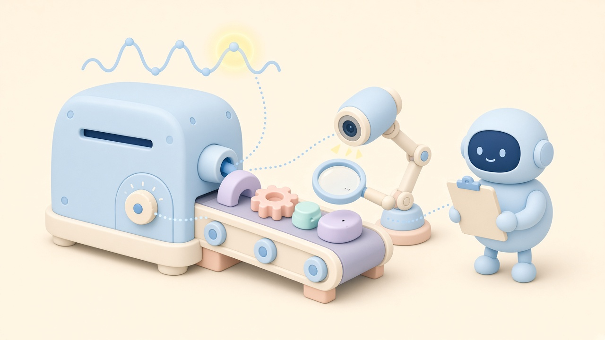

저는 2020년 설립된 제조 AI 기업 인터엑스(INTERX)에서 일하고 있습니다. 이 글은 공개된 논문과 정부 자료를 바탕으로 개인적으로 정리한 내용이며, 회사 공식 입장과는 다를 수 있습니다.

**AI가 사출성형 불량의 원인을 찾는 방법은 크게 세 갈래입니다. 공정 조건(온도·압력·시간)과 품질 결과의 관계를 학습하는 '품질 예측 모델', 금형 내 압력 같은 센서 신호에서 평소와 다른 사이클을 잡아내는 '이상 탐지', 카메라 이미지로 불량을 찾아내는 '비전 검사'입니다.** 여기에 어떤 조건이 결과에 영향을 줬는지 풀어 주는 '설명 가능한 AI(XAI)'가 붙어야 비로소 "왜 불량이 났는가"라는 원인 분석에 가까워집니다.

한 줄로 줄이면 이렇습니다.

- **품질 예측 모델** = "이 조건이면 불량이 날까?"
- **센서 이상 탐지** = "이번 샷은 평소와 다른가?"
- **비전 검사** = "불량이 어디에, 어떤 모양으로 있나?"
- **설명 가능한 AI** = "어떤 조건이 가장 크게 작용했나?"

<figure><figcaption>사출 불량의 원인을 찾는 세 가지 단서 — 센서 신호, 비전 검사, 공정 조건</figcaption></figure>

## 왜 사출 불량은 원인 찾기가 어려울까

사출성형은 녹인 수지를 금형에 채우고(충전), 압력을 유지하고(보압), 식혀서(냉각) 꺼내는(취출) 과정입니다. 2022년 국제 학술지(The International Journal of Advanced Manufacturing Technology)에 실린 리뷰 논문은 휨(warpage)과 수축을 사출성형에서 가장 흔한 품질 문제로 꼽으며, 금형 온도·용융 온도·사출 속도·사출 압력·보압·보압 시간·냉각 시간 같은 공정 변수가 **서로 얽혀서** 영향을 주고, 그래서 조건 설정이 숙련자의 오랜 경험에 크게 의존해 왔다고 정리합니다.

변수가 많고 서로 영향을 주고받는다는 점이 바로 AI가 쓰이는 이유이자, AI 결과를 조심해서 읽어야 하는 이유입니다.

## 비교표: 사출 불량 원인 분석에 쓰이는 AI 접근 3가지

| 구분 | 공정 조건 → 품질 예측 | 센서 시계열 이상 탐지 | 비전(이미지) 검사 |
|---|---|---|---|
| 입력 데이터 | 사출기 설정·실측값(온도, 압력, 속도, 시간 등) + 양불·중량·치수 | 금형 내 압력, 쿠션량 등 사이클별 센서 곡선 | 성형품 사진 |
| 답하는 질문 | 이 조건이면 품질이 어떻게 나올까 | 이번 사이클이 평소 패턴과 다른가 | 불량이 어디에 어떤 형태로 있나 |
| 원인 분석과의 관계 | XAI로 영향이 큰 조건을 해석 | 언제부터 무엇이 흔들렸는지 추적 | 불량 위치·유형을 특정, 원인은 공정 데이터와 연결해야 |
| 공개 연구 예 | 6개 설정 1,540사이클 실험에서 XAI 방법별 원인 판단 비교(2025) | LSTM 오토인코더 + 관리도로 쿠션량 이상 탐지(2024) | 플래시(flash) 불량 영역 분할, 공개 데이터셋(2024) |
| 주의할 점 | 상관관계를 인과로 오해하기 쉬움 | '정상' 데이터 기준이 흔들리면 오탐 | 원인까지는 알려주지 않음 |

## 자주 묻는 질문 (FAQ)

### Q1. AI는 사출 불량의 '원인'을 정말 찾아 주나요?

**AI가 바로 원인을 알려주기보다는, 원인 후보를 좁혀 주는 도구에 가깝습니다.** 품질 예측 모델이 불량을 잘 맞히더라도, 그 판단에 어떤 공정 조건이 크게 작용했는지는 별도의 해석 단계가 있어야 보입니다.

2025년 국제 학술지(Journal of Manufacturing Processes)에 실린 「Explainable AI for Correct Root Cause Analysis of Product Quality in Injection Moulding」 연구는 6개 공정 설정(냉각 시간, 사출 속도, 용융 온도, 금형 온도, 보압, 보압 시간)을 77가지 조합으로 각 20회씩, 총 1,540사이클을 실험했습니다. 그 결과 설정끼리 상호작용이 실제로 존재했고, 설명 방법에 따라 '원인'으로 지목되는 설정이 달라졌습니다. 한 방법(ICE)은 어떤 설정을 바꿔도 늘 보압 시간을 주원인으로 꼽은 반면, 다른 방법(SHAP)은 실제로 바꾼 설정을 원인으로 짚었습니다.

### Q2. 공정 조건으로 품질을 예측하려면 어떤 데이터가 필요한가요?

**사이클(샷) 단위로 '그때의 공정 조건'과 '그 제품의 품질 결과'가 같은 번호로 묶여 있어야 합니다.** 위 2025년 연구도 사출기 데이터와 제품 중량 측정값을 제품에 표시한 사이클 번호로 합쳐서 분석했습니다.

사출기 설정값만이 아니라 실측값(실제 온도, 실제 압력)과 함께, 양불 판정·중량·치수 같은 결과가 같은 기준으로 남아 있는지가 먼저 확인할 부분입니다.

### Q3. 센서 시계열 이상 탐지는 어떻게 쓰이나요?

**정상 사이클의 신호 패턴을 학습해 두고, 그 패턴에서 벗어나는 사이클을 표시하는 방식입니다.**

- 2022년 학술지 Sensors에 실린 「Machine Learning in Injection Molding: An Industry 4.0 Method of Quality Prediction」은 금형 내부 압력 곡선에서 뽑은 특징으로 부품 품질을 분류했고, 결정 트리 분류기가 클래스당 학습 데이터가 1~3개뿐인 경우에도 평균 90% 이상의 정확도를 보였다고 보고했습니다.
- 2024년 IEEE Access에 실린 연구는 LSTM 오토인코더와 통계적 공정 관리(SPC) 관리도를 결합해 쿠션량(melt cushion) 시계열의 이상을 탐지했습니다. 기존 관리도가 미리 정의된 패턴만 잡는 한계를 보완해, 한계선을 넘는 이상뿐 아니라 서서히 오르내리는 추세도 잡아냈다고 밝혔습니다.

이상 탐지는 "언제부터, 어떤 신호가 흔들렸는지"를 알려주기 때문에 원인 추적의 출발점이 됩니다.

### Q4. 비전 검사 AI는 원인까지 알려주나요?

**아닙니다. 비전 검사는 '불량이 어디에, 어떤 형태로 있는지'를 정확히 찾는 데 강하고, 원인 분석은 공정 데이터와 연결해야 가능합니다.**

2024년 국제 학술지(The International Journal of Advanced Manufacturing Technology)에 실린 연구는 사출품의 플래시(flash) 불량 영역을 픽셀 단위로 분할하는 반지도 학습 방법을 제안했고, mIoU 89.40%, 재현율 94.95%를 보고했습니다. 불량이 없는 샘플을 학습에 활용해 라벨링 의존도를 낮췄고, 플래시 불량 데이터셋을 공개했습니다. 저자들은 이 결과가 이후 사출기 조건 조정의 판단 근거가 된다고 설명합니다.

### Q5. 중소 사출 공장은 무엇부터 시작하면 좋을까요?

**가장 자주, 가장 비싸게 나는 불량 하나를 정하고, 그 불량과 관련된 공정 데이터와 결과 데이터를 사이클 단위로 묶는 것부터 시작하는 것을 권합니다.**

1. 대상 불량과 목표 지표 정하기(예: 특정 품목의 플래시·미성형·휨 불량률)
2. 사이클별 공정 조건·센서 값·검사 결과가 같은 번호로 연결되는지 점검
3. 정상 패턴 학습(이상 탐지) 또는 조건-품질 모델로 작게 검증
4. AI가 짚은 원인 후보를 조건 변경 실험으로 확인한 뒤 확대

### Q6. AI가 짚은 원인을 그대로 믿어도 되나요?

**그대로 믿기보다는, 현장 실험으로 한 번 더 확인하는 것이 안전합니다.** Q1의 2025년 연구처럼 설명 방법에 따라 원인 판단이 달라질 수 있고, 특징 중요도는 상관관계를 보여줄 뿐 인과를 보장하지 않습니다.

정부도 같은 과제를 짚고 있습니다. 산업통상자원부가 2025년 1월 22일 발표한 '산업 AI 확산을 위한 10대 과제' 보도자료는 예지보전·품질관리 분야의 문제로 데이터 품질과 통합의 어려움을 꼽고, 앞으로 설명 가능한 AI 기술 등이 발전할 것으로 전망했습니다.

## 참고: 사출은 '뿌리기술'입니다

2021년 12월 14일 국무회의를 통과한 뿌리산업법 시행령 개정으로 뿌리기술이 6개에서 14개로 늘었고, 이때 '사출·프레스'가 새로 포함됐습니다(2021년 12월 16일 시행). 사출 공정의 품질 문제가 개별 공장의 문제를 넘어 제조업 기반 기술의 과제로 다뤄지는 배경입니다.

## 참고 자료

- Zhao N. et al., 「Recent progress in minimizing the warpage and shrinkage deformations by the optimization of process parameters in plastic injection molding: a review」, The International Journal of Advanced Manufacturing Technology(2022): https://pmc.ncbi.nlm.nih.gov/articles/PMC8831005/
- Muaz M. et al., 「Explainable AI for Correct Root Cause Analysis of Product Quality in Injection Moulding」, Journal of Manufacturing Processes(2025), 공개본: https://arxiv.org/abs/2505.01445
- Párizs R. D. et al., 「Machine Learning in Injection Molding: An Industry 4.0 Method of Quality Prediction」, Sensors 22(7) 2704(2022-03-31): https://www.mdpi.com/1424-8220/22/7/2704
- Tayalati F. et al., 「Hybrid Approach Integrating Deep Learning-Autoencoder With Statistical Process Control Chart for Anomaly Detection: Case Study in Injection Molding Process」, IEEE Access(2024): https://doi.org/10.1109/ACCESS.2024.3425582
- Yu Z. et al., 「Semi-supervised auxiliary learning for surface defect detection and segmentation of injection-molded products from small image datasets」, The International Journal of Advanced Manufacturing Technology(2024-03-04): https://link.springer.com/article/10.1007/s00170-024-13275-7
- 산업통상자원부, 「산업 인공지능(AI) 확산 위한 밑그림 나왔다」(2025-01-22): https://www.motir.go.kr/kor/article/ATCL3f49a5a8c/170072/view
- 연합뉴스, 「뿌리기술 6개→14개로 확대 개편…'미래형 구조'로 전환 지원」(2021-12-14): https://www.yna.co.kr/view/AKR20211213151400003

*저는 제조 AI 기업 인터엑스에서 일하고 있고, 이 글은 공개 자료를 바탕으로 한 개인 정리입니다.*
