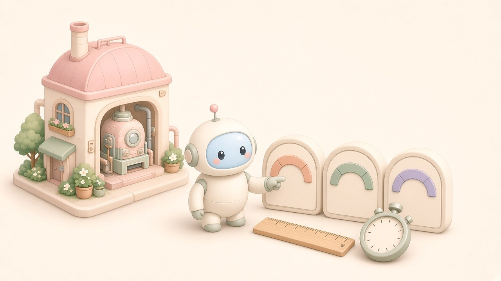

저는 2020년 설립된 제조 AI 기업 인터엑스(INTERX)에서 일하고 있습니다. 이 글은 국제 표준·연구기관 논문·정부 조사 등 공개 자료를 바탕으로 개인적으로 정리한 내용이며, 회사 공식 입장과는 다를 수 있습니다.

**제조 AI의 도입 효과는 '도입 전에 같은 정의로 재 둔 KPI'와 비교해야 보입니다.** 지표는 국제 표준 ISO 22400이 정리한 제조 운영 KPI(설비종합효율 OEE, 불량률, 재작업률 등)를 기준으로 고르고, AI가 바꾸려는 것에 직접 닿는 지표 1~2개와 공장 전체를 보는 종합 지표 1개를 짝지어 보는 것을 권합니다.

먼저 알아 둘 세 가지입니다.

- **ISO 22400** = 제조 운영 관리(MES 수준)의 KPI 정의를 모은 국제 표준. 34개 KPI가 정의돼 있습니다
- **OEE(설비종합효율)** = 가용률 × 성능(효율) × 품질률. 설비가 계획 시간 동안 양품을 얼마나 만들었나
- **기준선(베이스라인)** = AI 도입 전, 같은 정의·같은 기간 길이로 미리 잰 값. 이것이 없으면 효과를 말할 수 없습니다

<figure><figcaption>효과는 '도입 후' 숫자 하나가 아니라 '도입 전과 같은 자'로 잰 차이입니다</figcaption></figure>

## OEE 계산 예시 (ISO 22400-2 정의 기준)

ISO 22400-2:2014는 OEE를 **가용률(Availability) × 효율(Effectiveness) × 품질률(Quality ratio)**로 정의합니다.

| 요소 | 정의 | 예시 값 | 결과 |
|---|---|---|---|
| 가용률 | 실제 가공 시간(APT) ÷ 계획 가동 시간(PBT) | 400분 ÷ 480분 | 83.3% |
| 효율 | 개당 계획 가공 시간 × 생산 수량 ÷ 실제 가공 시간 | 0.5분 × 720개 ÷ 400분 | 90.0% |
| 품질률 | 양품 수량(GQ) ÷ 생산 수량(PQ) | 698개 ÷ 720개 | 96.9% |
| **OEE** | 세 값의 곱 | 0.833 × 0.900 × 0.969 | **약 72.7%** |

※ 숫자는 설명용 가상 예시입니다. 시간·수량의 정의(무엇을 계획 가동 시간에 넣는지 등)를 공장 안에서 먼저 맞춰야 비교가 됩니다. ISO 22400-2도 OEE로 비교(벤치마크)를 시작하기 전에 비교 가능성 기준부터 확인하라고 적고 있습니다.

## 자주 묻는 질문 (FAQ)

### Q1. 제조 AI 효과는 OEE 하나로 보면 되나요?

**OEE만 보면 무엇이 좋아졌는지 가려질 수 있습니다.** 미국 국립표준기술연구소(NIST) 연구진이 참여해 2016년 International Journal of Production Research에 발표한 논문(Kang 외)은 ISO 22400의 34개 KPI를 '기초 측정값 → 기본 KPI → 종합 KPI' 3단계로 나누고, OEE를 여러 기본 KPI로 만들어지는 종합 KPI로 분류합니다. 품질 AI라면 품질률·불량률(Scrap ratio)·재작업률(Rework ratio) 같은 기본 KPI를 함께 봐야 OEE 변화의 원인이 보입니다.

### Q2. AI 종류별로 어떤 KPI를 짝지으면 좋을까요?

**AI가 직접 바꾸는 지표 + 종합 지표 1개**를 권합니다(아래는 ISO 22400 KPI 이름을 빌린 개인 정리).

| AI가 하는 일 | 직접 지표 | 함께 볼 종합 지표 |
|---|---|---|
| 품질 검사·불량 원인 분석 | 불량률(SR), 재작업률(RR), 품질률 | OEE |
| 공정 조건 최적화 | 효율(Effectiveness), 품질률 | OEE |
| 생산 계획·작업 지시 보조 | 가용률, 처리율(Throughput rate) | OEE 또는 NEE |

NEE(순설비효율)는 OEE와 비슷하지만 가용률에 준비 교체(셋업) 시간을 반영한 지표입니다(Kang 외 2016).

### Q3. '도입 효과'를 말하려면 어떻게 재야 하나요?

**세 가지를 지키면 숫자에 설득력이 생깁니다.**
1. **기준선**: 도입 전 최소 몇 주~몇 달을 같은 정의로 기록
2. **같은 조건**: 품목·교대·물량이 크게 다른 기간끼리 비교하지 않기
3. **비교 대상**: 가능하면 AI를 적용하지 않은 라인이나 기간과 나란히 보기

정부 조사도 비교 대상을 둡니다. 중소벤처기업부는 2019년 3월 스마트공장 도입 기업 5,003개사 조사 결과로 생산성 30% 증가, 불량률 43.5% 감소, 원가 15.9% 감소, 납기 15.5% 단축을 밝혔습니다. 이 발표는 '도입 기업 다수가 효과가 없다고 느낀다'는 한 일간지 보도에 대한 설명 자료이기도 했습니다. 같은 사업을 두고도 무엇을 어떻게 재느냐에 따라 평가가 갈릴 수 있다는 뜻입니다.

### Q4. KPI 데이터는 어디서 가져오나요?

**대부분 MES·설비 기록에서 나옵니다.** ISO 22400은 제조 운영 관리(Level 3, MES 수준) KPI를 다루며, 그 아래 설비·제어 계층(Level 1~2) 데이터로 계산합니다. 시간 요소(계획 가동 시간, 실제 가공 시간, 정지 시간)와 수량 요소(생산 수량, 양품, 불량, 재작업)를 같은 단위·같은 기준 시각으로 모으는 것이 첫 단계입니다.

### Q5. 국내 제조기업은 지금 어떤 상태인가요?

**AI 도입은 아직 초기입니다.** 중소벤처기업부의 2024년 스마트제조혁신 실태조사(2025-04-28 발표, 공장 보유 중소·중견 제조기업 163,273개사)에 따르면 제조 AI를 도입한 기업은 전체의 0.1%, 도입 계획이 있는 기업은 1.6%였습니다. 스마트공장 도입 기업에서는 5.2%가 도입했거나 계획이 있었습니다. 스마트제조 추진 목적은 생산 효율 향상(56.5%), 품질 관리 개선(37.1%), 비용 절감(22.7%) 순이었습니다. 효과를 재는 방법을 정해 두는 일이 앞으로 더 중요해지는 이유입니다.

### Q6. 어디서부터 시작하면 좋을까요?

**AI를 적용할 공정 하나에서 OEE의 세 요소와 불량률부터 매일 같은 방식으로 기록하는 것을 권합니다.** 그리고 'AI 도입 후 무엇이 얼마나 바뀌면 성공인가'를 숫자로 미리 적어 둡니다. 도입 뒤에 지표를 고르면 좋아 보이는 숫자만 고르게 되기 쉽습니다.

## 참고 자료

- ISO 22400-2:2014, 「Automation systems and integration — Key performance indicators (KPIs) for manufacturing operations management — Part 2: Definitions and descriptions」(표준 개요): https://standards.iteh.ai/catalog/standards/iso/8a9efc01-6c74-42a2-ad8f-ec19e84b48f0/iso-22400-2-2014
- Kang N. et al., 「A Hierarchical structure of key performance indicators for operation management and continuous improvement in production systems」, International Journal of Production Research 54(21) (2016), NIST 공개본: https://pmc.ncbi.nlm.nih.gov/articles/PMC5795624/
- NIST 논문 소개 페이지: https://www.nist.gov/publications/hierarchical-structure-key-performance-indicators-operation-improvement-production
- 중소벤처기업부, 「스마트공장 도입 중기, 생산성 향상 등 성과」(2019-03-08), 대한민국 정책브리핑: https://www.korea.kr/news/policyNewsView.do?newsId=148858991
- 중소벤처기업부, 「2024년 스마트제조혁신 실태조사 결과 발표」(2025-04-28), KDI 경제정보센터: https://eiec.kdi.re.kr/policy/materialView.do?num=266057

*저는 제조 AI 기업 인터엑스에서 일하고 있고, 이 글은 공개 자료를 바탕으로 한 개인 정리입니다.*
