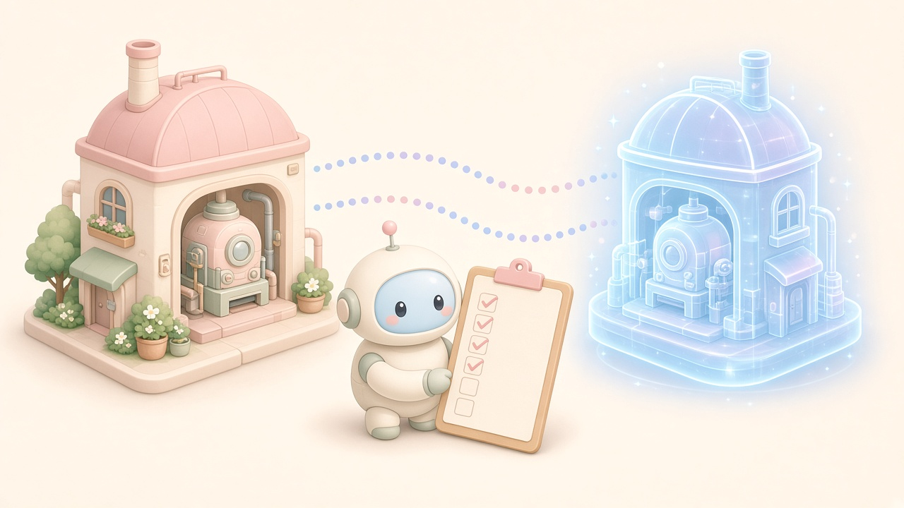

저는 2020년 설립된 제조 AI 기업 인터엑스(INTERX)에서 일하고 있습니다. 이 글은 국제 표준과 미국 국립표준기술연구소(NIST)·정부 자료 등 공개 자료를 바탕으로 개인적으로 정리한 내용이며, 회사 공식 입장과는 다를 수 있습니다.

**제조 디지털 트윈은 '공장을 3D로 그린 화면'이 아니라, 설비·공정·제품 같은 현장 대상의 디지털 표현이 데이터로 연결돼 실제 상태와 맞춰지는(동기화되는) 것입니다. 그래서 도입 준비는 화면이 아니라 목적, 대상, 데이터, 동기화 주기, 제어 범위, 보안 같은 10가지 질문에 먼저 답하는 데서 시작합니다.**

국제 표준 ISO/IEC 30173:2023은 디지털 트윈을 "대상 실체의 디지털 표현으로, 물리 상태와 디지털 상태가 적절한 동기화 주기로 수렴하도록 하는 데이터 연결을 갖춘 것"으로 정의합니다(필자 번역). 제조 분야 표준인 ISO 23247은 이를 '목적에 맞는(fit for purpose)' 디지털 표현이라고 설명합니다. 두 정의 모두 핵심은 **목적**과 **동기화**입니다.

## 체크리스트 10가지 한눈에 보기

1. 목적(유스케이스)을 하나로 좁혔나
2. 트윈으로 만들 대상을 정했나
3. 필요한 충실도(얼마나 정밀하게)를 정했나
4. 데이터 수집 경로와 형식이 있나
5. 동기화 주기를 정했나
6. 보기만 할지, 제어까지 할지 정했나
7. 데이터 표현 방식과 식별자를 정했나
8. MES·ERP 등 기존 시스템과 어떻게 연결할지 정했나
9. 보안·신뢰 위험을 점검했나
10. 검증 방법과 성과 지표를 정했나

<figure><figcaption>실제 공장과 디지털 트윈을 잇는 것은 데이터 연결과 동기화 — 도입 전 체크리스트부터</figcaption></figure>

## 체크리스트 상세표

| # | 체크 항목 | 확인할 질문 | 근거(공개 자료) |
|---|---|---|---|
| 1 | 목적 | 설비 상태 진단, 일정·경로 최적화, 가상 시운전 중 무엇을 풀 것인가 | NIST AMS 400-2(2021-05): 하나의 트윈이 모든 문제를 풀 수는 없고 목적별로 범위가 달라짐 |
| 2 | 대상 | 사람·설비·자재·공정·설비공간·환경·제품·문서 중 무엇을 표현할 것인가 | ISO 23247(관측 가능한 제조 요소, OME), ISO/IEC 30173(구성요소·자산·시스템·공정 트윈 유형) |
| 3 | 충실도 | 목적에 필요한 만큼만 정밀한가 | ISO 23247-1의 'fit for purpose' 정의 |
| 4 | 데이터 수집 | 어떤 센서·인터페이스·데이터 표준으로 모을 것인가 | NIST AMS 400-2의 ISO 23247 적용 절차 |
| 5 | 동기화 주기 | 실시간, 사이클 단위, 일 단위 중 무엇이 필요한가 | ISO/IEC 30173 '적절한 동기화 주기', NIST '응용이 정하는 주기' |
| 6 | 제어 범위 | 모니터링만 할지, 설비에 명령까지 보낼지 | ISO 23247-2 '데이터 수집 및 장치 제어' 영역, ISO/IEC 30173 '제어 루프' |
| 7 | 표현·식별자 | 기존 표준 모델을 쓸 수 있는가, 대상마다 고유 식별자가 있는가 | ISO 23247-3(가능하면 기존 표준·전사 고유 식별자 사용), IEC 63278-1(자산관리셸, 2023-12) |
| 8 | 기존 시스템 연동 | MES·ERP와 데이터를 어떻게 주고받나 | ISO 23247-2: 사용자 영역에 MES·ERP 같은 기업 애플리케이션 포함 |
| 9 | 보안·신뢰 | 센서 대량 설치, 데이터 집중, 원격 제어에 따른 위험을 점검했나 | NIST IR 8356(2025-02): 디지털 트윈 고유의 보안 과제 5가지 |
| 10 | 검증·지표 | 트윈이 현실을 잘 따라가는지 무엇으로 확인하고, 어떤 KPI로 효과를 볼 것인가 | ISO/IEC 30173(검증·확인 용어), NIST AMS 400-2(KPI 기반 이상 감지 등 기대 효과) |

## 자주 묻는 질문 (FAQ)

### Q1. 디지털 트윈은 3D 시뮬레이션과 무엇이 다른가요?

**가장 큰 차이는 '실제 대상과의 데이터 연결과 동기화'입니다.** ISO/IEC 30173:2023 정의에 따르면 디지털 트윈은 물리 상태와 디지털 상태가 수렴하도록 데이터로 연결돼 있어야 합니다. 같은 표준은 디지털 트윈이 연결·통합·분석·시뮬레이션·시각화·최적화·협업 기능의 일부 또는 전부를 가진다고 설명합니다. 즉 3D 시각화와 시뮬레이션은 트윈의 기능 중 하나일 수 있지만, 그것만으로 트윈이 되지는 않습니다.

### Q2. 제조 디지털 트윈에도 국제 표준이 있나요?

**있습니다. 대표적인 것이 ISO 23247 시리즈(제조용 디지털 트윈 프레임워크)입니다.**

- Part 1(개요·일반 원칙): 2021년 10월 발행
- Part 2(참조 아키텍처), Part 3(제조 요소의 디지털 표현), Part 4(정보 교환), Part 5(디지털 스레드)
- Part 6(디지털 트윈 조합): 2026년 7월 발행

분야 공통 용어는 ISO/IEC 30173:2023(디지털 트윈 개념·용어, 2023년 11월판)이 다룹니다.

### Q3. ISO 23247의 참조 아키텍처는 어떻게 생겼나요?

**네 개 영역으로 나뉩니다.** NIST가 2021년 5월 발간한 「Use Case Scenarios for Digital Twin Implementation Based on ISO 23247」(NIST AMS 400-2)의 설명을 정리하면 다음과 같습니다.

1. 관측 대상 제조 영역: 실제 설비·자재·공정 등(트윈 바깥)
2. 데이터 수집 및 장치 제어 영역: 센서로 데이터를 모으고 설비를 제어해 트윈과 동기화
3. 코어 영역: 트윈의 운영·관리, 분석·시뮬레이션·최적화 서비스
4. 사용자 영역: 사람, 그리고 MES·ERP 같은 기업 애플리케이션이나 다른 트윈

체크리스트 4~8번은 사실상 이 네 영역을 하나씩 채우는 질문입니다.

### Q4. 중소 제조기업도 도입할 수 있나요?

**작게 시작하면 가능합니다. 다만 우리 공장이 어느 단계인지부터 확인하는 것이 순서입니다.** NIST AMS 400-2는 중소기업이 디지털 트윈 도입에 어려움을 겪는 이유로 정의가 제각각이고 용어가 일관되지 않으며 표준화된 구축 절차가 없다는 점을 꼽고, 표준이 이를 해결하는 데 도움이 된다고 봅니다.

중소벤처기업부 스마트공장 수준 기준에서 4단계(중간2, 최적화)는 "공정 운영 시뮬레이션을 통한 사전 대응"이 가능한 수준, 5단계(고도화, 자율 운영)는 주요 도구로 AR/VR·CPS를 둡니다. 데이터 수집·모니터링(1~2단계)이 갖춰져 있어야 트윈의 동기화도 가능합니다.

### Q5. 여러 개의 디지털 트윈을 합칠 수 있나요?

**표준이 그 방법을 다루기 시작했습니다.** 2026년 7월 발행된 ISO 23247-6은 디지털 트윈 조합 방식을 통합형(integrated)·단일형(unified)·연합형(federated) 세 가지로 나누고, 서로 다른 주체(공급사, 솔루션 제공자, 사내 개발팀)가 만든 트윈끼리 상호운용하기 위한 단계별 지침을 제시합니다. 처음부터 큰 트윈 하나를 만들기보다, 목적별 트윈을 나중에 묶을 수 있게 설계해 두는 것이 현실적입니다.

### Q6. 보안과 정부 정책은 어떻게 봐야 하나요?

**보안은 처음부터 체크리스트에 넣어야 합니다.** NIST는 2025년 2월 14일 발간한 IR 8356 「Security and Trust Considerations for Digital Twin Technology」에서 디지털 트윈에 특별한 보안 고려가 필요한 새로운 특징 다섯 가지로 ① 대상의 대규모 계측(주로 IoT) ② 측정값의 중앙 집중 ③ 대상 운영의 시각화·표현 ④ 원격 제어 ⑤ 보편적 접근·제어를 가능하게 하는 트윈 정의 표준을 꼽았습니다.

정책 측면에서는 과학기술정보통신부가 2021년 '디지털 트윈 활성화 전략'을 발표하고 주력산업에 디지털 트윈을 적용해 생산·운영을 효율화하는 것을 전략 과제에 포함했습니다. 산업통상자원부는 2025년 1월 22일 발표한 '산업 AI 확산 10대 과제'에서 AI 에이전트를 디지털 트윈과 연계해 자율제조 선도 프로젝트로 개발하겠다고 밝혔습니다.

## 참고 자료

- ISO/IEC 30173:2023 Digital twin — Concepts and terminology(2023-11): https://www.iso.org/standard/81442.html
- ISO 23247-1:2021 Digital twin framework for manufacturing — Part 1(2021-10): https://www.iso.org/standard/75066.html
- ISO 23247-6:2026 Digital twin framework for manufacturing — Part 6: Digital twin composition(2026-07): https://www.iso.org/standard/87426.html
- Shao G., NIST AMS 400-2 「Use Case Scenarios for Digital Twin Implementation Based on ISO 23247」(2021-05): https://doi.org/10.6028/NIST.AMS.400-2
- NIST IR 8356 「Security and Trust Considerations for Digital Twin Technology」(2025-02-14): https://www.nist.gov/news-events/news/2025/02/security-and-trust-considerations-digital-twin-technology-nist-releases-ir
- IEC 63278-1:2023 Asset Administration Shell for industrial applications — Part 1(2023-12): https://webstore.iec.ch/en/publication/65628
- 중소벤처기업부 스마트공장 사업관리시스템, Introduction of Support Project(스마트공장 수준): https://www.smart-factory.kr/eng/smartFactory.do?menuId=03
- 과학기술정보통신부, 「디지털 트윈 초혁신 프로젝트…활성화 전략 4가지」, 정책브리핑(2021-10-15): https://www.korea.kr/news/policyFocusView.do?newsId=148894352
- 산업통상자원부, 「산업 인공지능(AI) 확산 위한 밑그림 나왔다」(2025-01-22): https://www.motir.go.kr/kor/article/ATCL3f49a5a8c/170072/view

*저는 제조 AI 기업 인터엑스에서 일하고 있고, 이 글은 공개 자료를 바탕으로 한 개인 정리입니다.*
