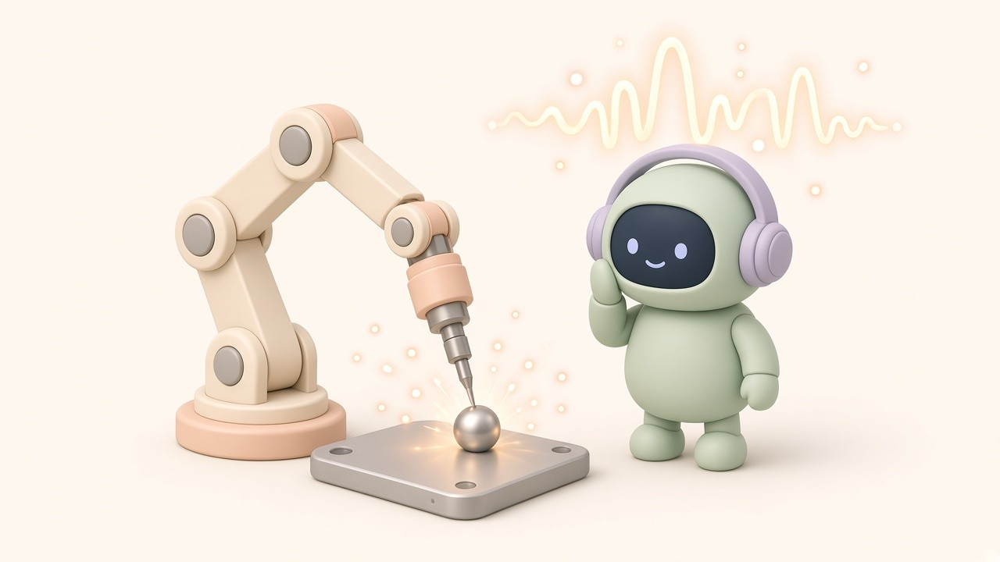

*Disclosure: I work at INTERX, a Korean manufacturing AI company (founded 2020). This article is my personal summary of public review papers and international standards; it does not represent my employer's official position.*

AI for weld quality works at two points in time. **After welding,** models read photos or radiographic images to find defects. **During welding,** models read sensor signals such as current, voltage, sound, and light to catch defects as they form. Most recent research focuses on the second, because a defect found during the weld can still be corrected, or the weld can be stopped.

A short map of what each signal is mainly used for in the literature:

- **Current and voltage:** diagnosing defects in arc and resistance spot welding, and monitoring process conditions
- **Sound and acoustic emission:** predicting weld penetration
- **Optical signals:** diagnosing defects in laser welding
- **Cameras on the weld pool or bead:** surface defects only, not internal ones

<figure><figcaption>Weld quality AI does not only watch the sparks. It listens to current, sound, and light</figcaption></figure>

## Why "during" matters

A 2022 review in *Welding in the World*, "In situ detection of welding defects: a review" (Madhvacharyula et al.), puts the problem plainly. Non-destructive testing after deposition helps assess the quality of a component but offers no input while welding is under way. Real-time detection lets operators take corrective measures or halt the weld, saving time and material. The review classifies in-situ methods by input signal: audio, welding current and voltage, optical signals, and combinations of these.

## Why a camera is not enough

It is tempting to point a camera at the weld and call it done. A 2024 review in the *Journal of Welding and Joining*, "Review on Welding Process Monitoring Based on Deep Learning using Time-Series Data" (Lee et al.), explains the limits. Camera-based monitoring of the molten pool or bead captures external appearance, but it cannot identify internal defects such as porosity or cracks. Its performance also degrades significantly when fumes are heavy or the plasma is intense. That is why current, voltage, acoustic, and optical sensors have drawn attention. Their time-series signals carry information about the physical phenomena of the weld itself.

## Matching signals to problems

Lee et al. summarize the research pattern:

- **Penetration state** is predicted mainly from **acoustic** signals.
- **Defect diagnosis** relies on **current and voltage** in arc and resistance spot welding, and on **optical** signals in laser welding.
- **Process conditions,** such as base-material alignment or shielding-gas flow, are monitored with current, voltage, and resistance signals, and in some studies controlled in real time.

If your welding power sources already log current and voltage, that log is the first asset to check.

## Which models, and why

Weld signals are nonlinear and non-stationary, meaning their character changes over the course of a weld. The review describes two common approaches. One feeds the one-dimensional signal directly to LSTM networks, sometimes with a 1D convolution layer at the input or an attention mechanism at the output. The other converts the signal into a two-dimensional time-frequency image with a short-time Fourier transform or a wavelet transform, then uses a convolutional neural network, an approach that has been actively researched.

## Seeing why the model decided

Trust matters on the shop floor. Lee et al. highlight explainable AI. SHAP can rank which signal features contributed most to a quality prediction. Grad-CAM can show which region of a time-frequency image a CNN relied on. They also expect physics-informed neural networks, which combine governing equations with learning, to be used to predict phenomena such as flow and temperature in the molten pool. In their view, these tools may become essential for welding automation, not just monitoring.

## Labels come from the standard, not the model

An AI is only as consistent as its definition of "defective". For fusion-welded joints in steel, nickel, titanium, and their alloys, ISO 5817 specifies quality levels for imperfections. It defines three levels, B, C, and D, with B the most demanding. Korea has an identical national adoption, KS B ISO 5817. Decide which level your labels follow before you train anything. Otherwise people and the model will disagree about the same bead.

## A practical first step

Link every weld to its data. For each joint, keep the power-source log, the welding conditions, and the inspection result (visual or NDT) under the same identifier. Without that link, no model, LSTM or CNN, has anything to learn from.

The comparison table of all five data types is in the original Korean post: [sungsiwon.github.io/ko/welding-quality-ai-data/](https://sungsiwon.github.io/ko/welding-quality-ai-data/)

## Sources
- Madhvacharyula et al., "In situ detection of welding defects: a review," *Welding in the World* (2022): https://link.springer.com/article/10.1007/s40194-021-01229-6
- Lee et al., "Review on Welding Process Monitoring Based on Deep Learning using Time-Series Data," *Journal of Welding and Joining* 42(4):333 (2024): https://www.e-jwj.org/journal/view.php?doi=10.5781/jwj.2024.42.4.1
- ISO 5817:2023, Welding — Fusion-welded joints … Quality levels for imperfections: https://www.iso.org/standard/80209.html
- KS B ISO 5817 (Korean Standards, Korean): https://www.kssn.net/search/stddetail.do?itemNo=K001010131885

*I work at INTERX, a Korean manufacturing AI company (founded 2020). Views are my own.*
