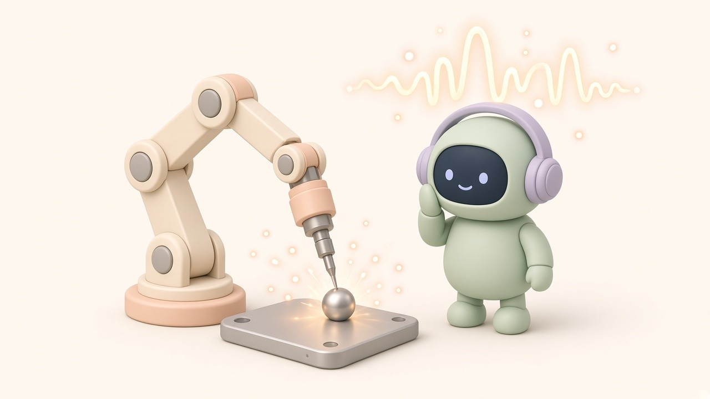

저는 2020년 설립된 제조 AI 기업 인터엑스(INTERX)에서 일하고 있습니다. 이 글은 공개된 논문과 표준·정부 자료를 바탕으로 개인적으로 정리한 내용이며, 회사 공식 입장과는 다를 수 있습니다.

**용접 품질 AI는 크게 두 시점에서 쓰입니다. 용접이 끝난 뒤 사진·방사선 이미지로 결함을 찾는 '사후 검사', 그리고 용접하는 동안 전류·전압·소리·빛 같은 센서 신호로 결함을 미리 잡는 '실시간(인시투) 모니터링'입니다.** 최근 연구가 몰리는 쪽은 후자입니다. 용접이 끝난 뒤에는 고칠 수 없지만, 하는 동안 알면 조건을 바꾸거나 멈출 수 있기 때문입니다.

데이터별로 한 줄씩 정리하면 이렇습니다.

- **전류·전압** = 아크·저항 점용접에서 결함 진단, 공정 조건 이상 감시
- **소리(음향)** = 용입(얼마나 깊이 녹아 들어갔나) 상태 예측
- **빛(광 신호)** = 레이저 용접의 결함 진단
- **카메라(용융풀·비드)** = 겉모양 결함. 기공·균열 같은 내부 결함은 못 봄

<figure><figcaption>용접 품질 AI는 불꽃만 보지 않습니다. 전류, 소리, 빛까지 '듣고' 봅니다</figcaption></figure>

## 왜 '용접하는 동안'이 중요할까

2022년 1월 국제 학술지 Welding in the World에 실린 리뷰 「In situ detection of welding defects: a review」(Madhvacharyula 외)는 용접 후 비파괴검사(NDT)가 부품 품질을 평가하는 데는 도움이 되지만 **용접하는 동안에는 아무 정보도 주지 못한다**고 짚습니다. 반면 실시간 검출은 용접 중에 결함을 찾아 바로 조치하거나 용접을 멈춰 시간과 재료 낭비를 줄일 수 있다고 정리합니다. 이 리뷰는 방법을 입력 신호별(소리, 전류·전압, 광 신호, 이들의 조합)로 분류합니다.

## 비교표: 용접 품질 AI가 쓰는 데이터 5가지

| 데이터 | 언제 | 주로 쓰는 곳(연구 기준) | 강점 | 한계 |
|---|---|---|---|---|
| 전류·전압 | 용접 중 | 아크·저항 점용접 결함 진단, 모재 정렬·보호가스 유량 같은 조건 감시 | 용접기에서 바로 얻기 쉬움 | 용접법마다 신호 특성이 다름 |
| 소리·음향 방출 | 용접 중 | 용입 상태 예측 | 비접촉, 실시간 | 주변 소음 영향 |
| 빛(광 신호) | 용접 중 | 레이저 용접 결함 진단 | 레이저 용접에 적합 | 센서 설치 위치 제약 |
| 카메라(용융풀·비드) | 용접 중·후 | 겉모양 결함 | 직관적, 사람이 확인 쉬움 | 내부 결함(기공·균열) 못 봄, 흄·플라스마가 강하면 성능 저하 |
| 방사선·초음파 등 NDT 이미지 | 용접 후 | 내부 결함 판정 | 내부까지 확인 | 용접 중에는 정보 없음 |

출처: Lee 외(2024, 대한용접·접합학회지) 결론, Madhvacharyula 외(2022) 초록을 바탕으로 정리.

## 자주 묻는 질문 (FAQ)

### Q1. 용접 품질 AI는 어떤 모델을 쓰나요?

**센서 신호를 그대로 쓰면 LSTM 계열, 신호를 이미지로 바꾸면 CNN 계열이 주로 쓰입니다.** 2024년 대한용접·접합학회지(Journal of Welding and Joining)에 실린 리뷰 「Review on Welding Process Monitoring Based on Deep Learning using Time-Series Data」(Lee 외)는 용접 신호가 비선형·비정상(시간에 따라 성질이 변하는) 특성을 가져서, 1차원 시계열에는 LSTM이, 신호를 단시간 푸리에 변환(STFT)이나 웨이블릿 변환(WT)으로 2차원 시간-주파수 이미지로 바꾼 경우에는 CNN이 많이 쓰인다고 정리합니다.

### Q2. 카메라로 용접부를 찍으면 되는 것 아닌가요?

**겉모양은 볼 수 있지만, 내부 결함은 보지 못합니다.** 같은 리뷰는 용융풀·비드를 찍는 카메라 방식이 기공(porosity)이나 균열 같은 내부 결함을 찾지 못하고, 흄이 많거나 플라스마가 강한 조건에서는 성능이 크게 떨어진다고 지적합니다. 그래서 전류·전압·음향·광 센서 같은 시계열 신호가 주목받는다고 설명합니다.

### Q3. 어떤 센서를 먼저 붙여야 하나요?

**용접법과 잡고 싶은 결함에 따라 다릅니다.** Lee 외(2024)의 정리를 따르면 용입 상태 예측에는 음향 신호가, 결함 진단에는 아크·저항 점용접에서 전류·전압 신호가, 레이저 용접에서는 광 신호가 주로 쓰였습니다. 아크·저항 점용접에서는 전류·전압·저항 신호로 모재 정렬이나 보호가스 유량 같은 조건을 감시하고 실시간 제어하는 연구도 있습니다. 용접기가 이미 전류·전압을 기록한다면 그 데이터가 가장 먼저 확인해 볼 자원입니다.

### Q4. AI가 '불량'이라고 한 근거를 볼 수 있나요?

**설명 가능한 AI(XAI)로 일부 볼 수 있습니다.** Lee 외(2024)는 SHAP으로 품질 예측에 크게 기여한 신호 특징의 순위를 매기거나, Grad-CAM으로 시간-주파수 이미지의 어느 부분을 보고 판단했는지 시각화하는 연구를 소개합니다. 앞으로는 XAI와 물리 법칙을 결합한 신경망(PINN)이 용접 공정 모니터링에 더 쓰일 것으로 전망합니다.

### Q5. AI 판정 기준은 무엇에 맞춰야 하나요?

**사람이 쓰던 품질 기준을 그대로 정답으로 써야 합니다.** 용융 용접부의 결함 허용 수준은 국제 표준 ISO 5817이 정하고 있고, 품질 등급을 B·C·D 세 단계로 나눕니다(B가 가장 엄격). 국내에는 이 표준과 같은 내용의 KS B ISO 5817이 있습니다. AI 학습용 라벨(양품/불량)이 어느 등급 기준인지 먼저 정해 두지 않으면, 같은 비드를 두고 사람과 AI가 다른 답을 내게 됩니다.

### Q6. 중소 용접 공장은 무엇부터 해 보면 좋을까요?

**용접 건마다 '신호 기록'과 '검사 결과'를 같은 번호로 묶는 것부터입니다.** 용접기 전류·전압 로그, 작업 조건, 그리고 그 용접부의 검사 결과(외관·NDT)가 한 번호로 연결돼 있어야 어떤 AI든 학습할 수 있습니다. 용접은 2021년 뿌리산업법 시행령 개정 전부터 주조·금형·소성가공·표면처리·열처리와 함께 6대 뿌리기술에 속해 온 제조업의 기반 공정입니다(2021년 개정으로 뿌리기술은 14개로 늘었습니다).

## 참고 자료

- Madhvacharyula A. S. et al., 「In situ detection of welding defects: a review」, Welding in the World (2022-01-21): https://link.springer.com/article/10.1007/s40194-021-01229-6
- Lee J. et al., 「Review on Welding Process Monitoring Based on Deep Learning using Time-Series Data」, Journal of Welding and Joining 42(4) 333 (2024-08-31): https://www.e-jwj.org/journal/view.php?doi=10.5781/jwj.2024.42.4.1
- ISO 5817:2023, 「Welding — Fusion-welded joints in steel, nickel, titanium and their alloys (beam welding excluded) — Quality levels for imperfections」: https://www.iso.org/standard/80209.html
- 한국표준정보망, KS B ISO 5817 (2021-01-26 발행, ISO 5817:2014 부합): https://www.kssn.net/search/stddetail.do?itemNo=K001010131885
- 연합뉴스, 「뿌리기술 6개→14개로 확대 개편…'미래형 구조'로 전환 지원」(2021-12-14): https://www.yna.co.kr/view/AKR20211213151400003

*저는 제조 AI 기업 인터엑스에서 일하고 있고, 이 글은 공개 자료를 바탕으로 한 개인 정리입니다.*
